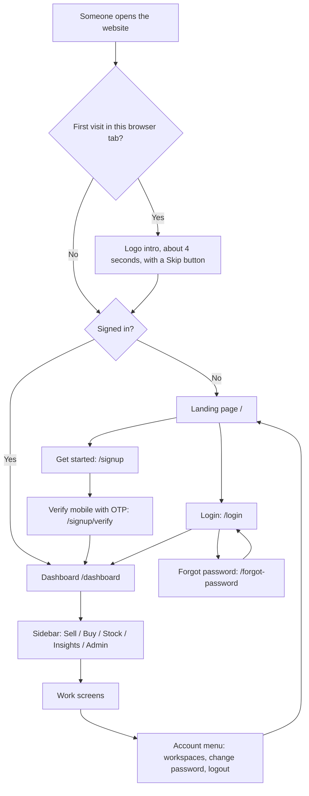
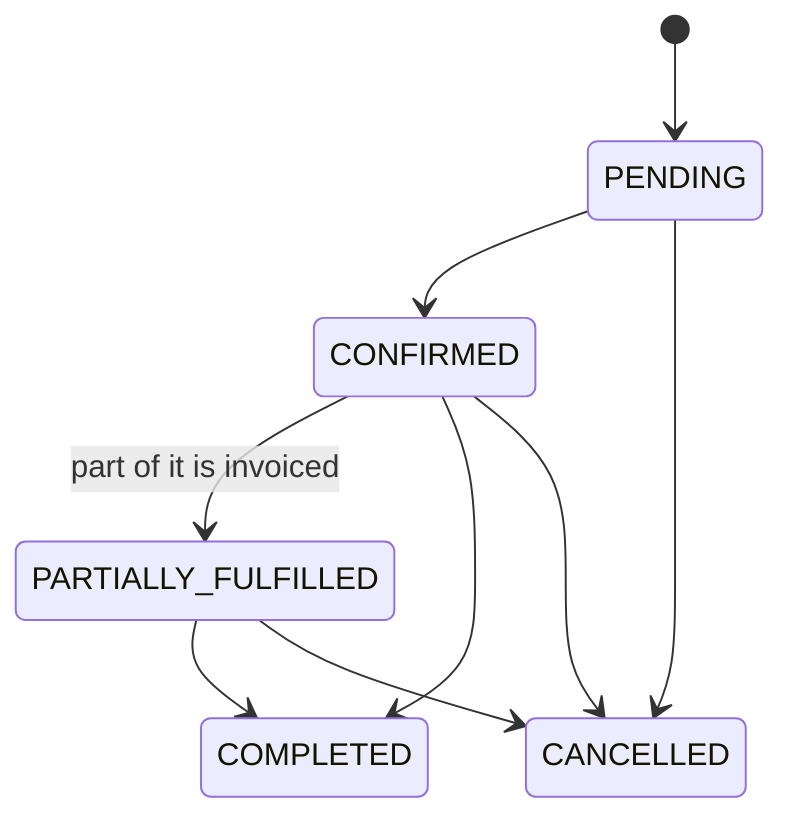
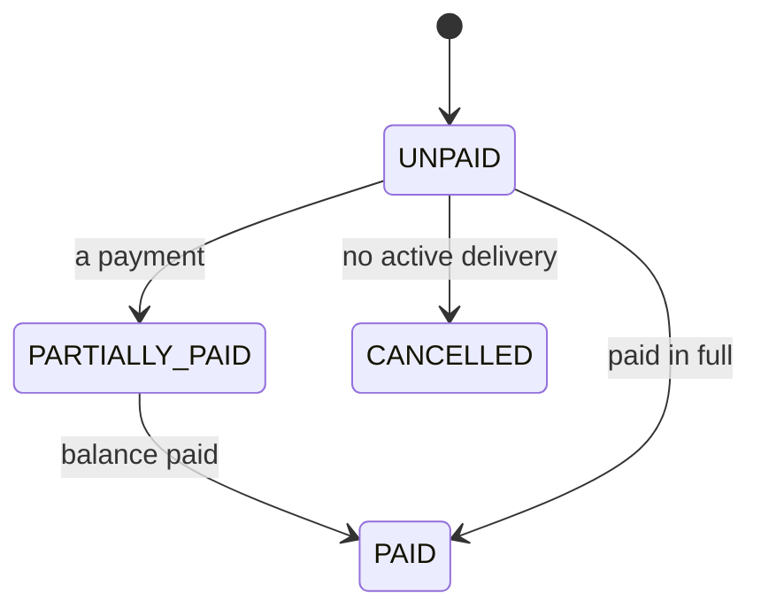
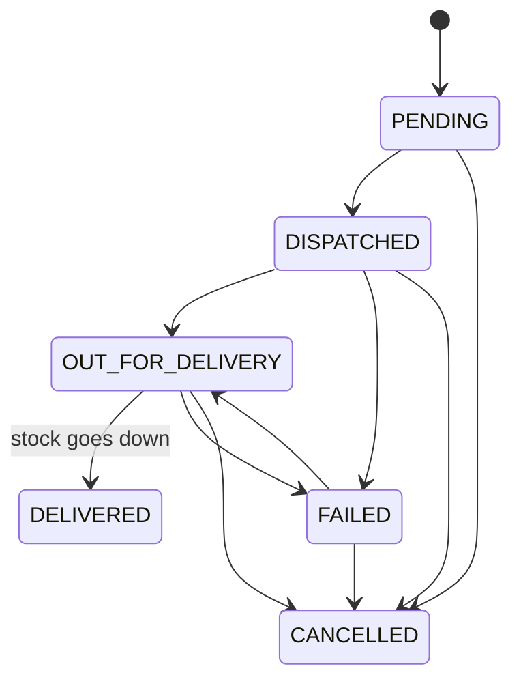
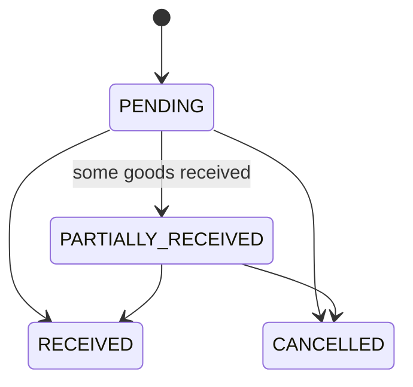
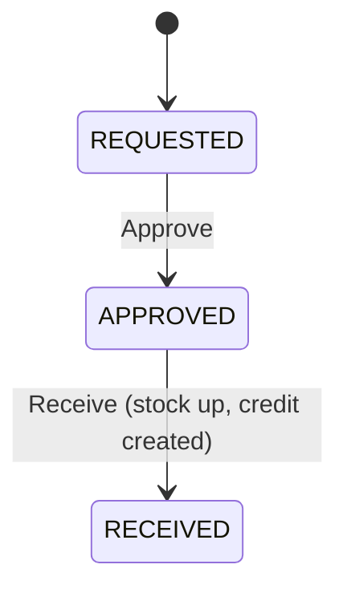

# DukaanPulse: App Flow

|                             |                                                                                                                                                                 |
| --------------------------- | --------------------------------------------------------------------------------------------------------------------------------------------------------------- |
| **Product**           | DukaanPulse                                                                                                                                                     |
| **Document type**     | App Flow: every screen, how people move between them, and what each user journey looks like                                                                     |
| **Related documents** | [PRD](01-PRD.md), [TRD](02-TRD.md), [UI/UX Brief](04-UIUX-DESIGN-BRIEF.md), [Backend Schema](05-BACKEND-SCHEMA.md), [Implementation Plan](06-IMPLEMENTATION-PLAN.md) |

---

## 1. The whole app on one page



---

## 2. Screens and routes

### 2.1 Public screens (no login needed)

| Route                  | Screen                                 | Purpose                                                                                                                                                                                  |
| ---------------------- | -------------------------------------- | ---------------------------------------------------------------------------------------------------------------------------------------------------------------------------------------- |
| `/`                  | **Landing page**                 | Explains the product. Buttons: Get started, Login. Signed-in users are sent to `/dashboard` instead.                                                                                   |
| `/login`             | **Login**                        | Username or mobile number and password.                                                                                                                                                  |
| `/signup`            | **Create your business account** | Name, business name, mobile number, username, password.                                                                                                                                  |
| `/signup/verify`     | **Verify your mobile number**    | Enter the 6-digit OTP. Resend after 30 seconds. Creates the workspace and signs in.                                                                                                      |
| `/forgot-password`   | **Reset your password**          | Three steps on one page: mobile number, OTP, new password.                                                                                                                               |
| `/invitation/accept` | **Join a workspace**             | Opened from the invitation link (`?token=...`). New people choose name, username and password. People who already have an account enter only their current password. Then an OTP step. |

### 2.2 Private screens (login needed)

| Route                  | Screen                            | Needs permission                                          |
| ---------------------- | --------------------------------- | --------------------------------------------------------- |
| `/dashboard`         | Dashboard                         | `dashboard:read`                                        |
| `/customers`         | Customers                         | `customers:read`                                        |
| `/orders`            | Orders                            | `orders:read`, `customers:read`, `products:read`    |
| `/invoices`          | Invoices                          | `invoices:read`, `orders:read`                        |
| `/invoices/:id`      | Invoice detail                    | `invoices:read`                                         |
| `/deliveries`        | Deliveries                        | `deliveries:read`, `invoices:read`                    |
| `/payments`          | Customer payments                 | `payments:read`, `invoices:read`                      |
| `/returns`           | Returns                           | `returns:read`, `invoices:read`                       |
| `/suppliers`         | Suppliers                         | `suppliers:read`                                        |
| `/purchases`         | Purchases                         | `purchases:read`, `suppliers:read`, `products:read` |
| `/purchase-payments` | Supplier payments                 | `purchase_payments:read`, `purchases:read`            |
| `/products`          | Products                          | `products:read`, `categories:read`                    |
| `/inventory`         | Stock lookup                      | `inventory:read`, `products:read`                     |
| `/cash-credit`       | Cash & Credit                     | `reports:read`                                          |
| `/users`             | Users                             | `users:manage`                                          |
| anything else          | "Coming soon" page inside the app | (login only)                                              |

If a signed-in person types the address of a page their role cannot use, they see an **Access denied** panel inside the normal layout, not a blank page.

---

## 3. Navigation

### 3.1 Desktop: fixed sidebar

The sidebar stays in place while the page scrolls. Only its own menu scrolls if it is long.

```
[ Logo ]

Dashboard
Sell        Customers · Orders · Invoices · Deliveries · Customer payments · Returns
Buy         Suppliers · Purchases · Supplier payments
Stock       Products · Stock lookup
Insights    Cash & Credit
Admin       Users

[ Avatar  Name / Role  ⌃ ]   ← account menu
```

- A link is **shown only if the person has the permission** for it. Groups with no visible links disappear.
- The current page has a **brass bar** on its left edge.

### 3.2 Phone and small screens (under 900 px)

- A **top bar** with a menu button and the logo replaces the sidebar.
- Tapping the menu button slides the sidebar in as a **drawer** over the page, with a dark backdrop.
- The drawer closes when a link is chosen, when the backdrop is tapped, or on Escape.
- Dialogs open as **bottom sheets**.

### 3.3 Account menu (bottom of the sidebar)

One line shows the avatar, name and role. Clicking it opens a menu:

1. Name and `Business · Role`
2. **Workspaces** (only if the person belongs to more than one) with a tick on the current one
3. **Change password**
4. **Logout**

### 3.4 Who sees what

Calculated from the permission list in `core/permissions.py` and the links above.

| Role                    | Sidebar links shown                                                                                               | Links hidden                                               |
| ----------------------- | ----------------------------------------------------------------------------------------------------------------- | ---------------------------------------------------------- |
| **Owner / Admin** | All 14                                                                                                            | None                                                       |
| **Sales**         | Dashboard, Customers, Orders, Invoices, Deliveries, Customer payments, Returns, Suppliers, Products, Stock lookup | Purchases, Supplier payments, Cash & Credit, Users         |
| **Warehouse**     | Dashboard, Customers, Orders, Invoices, Deliveries, Returns, Suppliers, Purchases, Products, Stock lookup         | Customer payments, Supplier payments, Cash & Credit, Users |
| **Accounts**      | Everything except Users (includes Customer payments, Supplier payments and Cash & Credit)                         | Users                                                      |
| **Viewer**        | All read-only business screens                                                                                    | Cash & Credit, Users                                       |

Seeing a screen is not the same as changing data. For example, **Sales** can open Deliveries but only **Warehouse**, Admin and Owner can create or move a delivery.

---|---|
| **Owner / Admin** | Everything, including Users and Cash & Credit |
| **Sales** | Dashboard, Sell group, Stock group (not Suppliers, Purchases, Supplier payments, Cash & Credit, Users) |
| **Warehouse** | Dashboard, Deliveries, Orders and Invoices (read), Buy group, Stock group |
| **Accounts** | Dashboard, Customer payments, Supplier payments, Returns, Cash & Credit, and read access to most of the rest |
| **Viewer** | All read-only screens except Cash & Credit and Users |

The exact rule is always the permission list in section 2.2.

---

## 4. First-visit experience

1. **Logo intro** (once per browser tab session). On a dark maroon screen the logo draws itself, the name "DukaanPulse" opens out of it, holds, folds back into the logo, and the screen fades. A **Skip** button is always available. People who prefer reduced motion see it end almost at once.
2. While the intro plays, the app is already checking whether the person is signed in.
3. **Signed out** → landing page. **Signed in** → dashboard.
4. Landing page order: hero → "sound familiar?" problems → how it works (Buy, Stock, Sell, Collect) → features → Cash & Credit showcase → security → final call to action → footer.

---

## 5. User journeys

### J1. A new owner creates a business

1. Landing page → **Get started**.
2. Fill in full name, business name, mobile number, username, password (12+ characters) and confirm it.
3. Press **Send verification code**. An OTP arrives by SMS.
4. Enter the 6-digit code on **Verify your mobile number** (resend allowed after 30 seconds, 5 wrong tries lock the code).
5. The business workspace and the Owner account are created, and the person lands on the **Dashboard**.
6. Suggested first steps: add categories and products, add customers and suppliers, invite staff.

### J2. A staff member is invited

1. Owner or Admin opens **Users**, chooses **Invite**, enters the person's mobile number and a role.
2. The app shows a one-time **invitation link**. The owner shares it (for example on WhatsApp).
3. The invited person opens the link.
   - **New to DukaanPulse:** enters name, username and password.
   - **Already has an account:** enters only the current password.
4. An OTP is sent to the invited mobile number. They enter it.
5. They join the workspace with the given role and land on the dashboard.

### J3. Returning login

1. `/login` → enter username or mobile number and password.
2. If the person belongs to several businesses, the first business they joined opens; they can switch from the account menu.
3. They land on the page they were trying to reach, or on the dashboard.

### J4. Forgot password

1. `/forgot-password` → enter mobile number → **Send code**. The message is the same whether or not the number is registered.
2. Enter the OTP → choose a new password and confirm.
3. Back at `/login` with a "password reset complete" notice. All old sessions are signed out.

### J5. Daily selling: order to money

1. **Customers**: find or add the customer.
2. **Orders → New order**: pick the customer, add products with packaging unit and quantity. Order starts as `PENDING`.
3. Confirm the order (`CONFIRMED`).
4. **Invoices → New invoice**: pick a confirmed order, choose the quantities to bill (full or part), enter the invoice number and date. The server checks quantities and totals. The invoice starts `UNPAID`.
5. **Deliveries → New delivery** for the invoice (done by Warehouse, Admin or Owner). The address fills in from the customer.
6. Move the delivery: `DISPATCHED` → `OUT_FOR_DELIVERY` → `DELIVERED`. **Stock goes down at `DELIVERED`.** If stock is short, the action is refused with a clear message.
7. **Customer payments → Record payment** (Sales, Accounts, Admin or Owner). The invoice becomes `PARTIALLY_PAID` or `PAID`.
8. Optional: **Apply credit** on the invoice to use the customer's stored credit.

### J6. Buying stock

1. **Suppliers** and **Products** must exist.
2. **Purchases → New purchase**: supplier, date, items with quantity and rate. Status `PENDING`.
3. When goods arrive, **Receive**: enter the received quantity for each item. Stock goes up. Status becomes `PARTIALLY_RECEIVED` or `RECEIVED`.
4. **Supplier payments → Record payment** against the purchase. A payment cannot exceed what is still payable.

### J7. A customer returns goods

1. **Returns → New return**: choose the invoice, the items and quantities (limited to what was sold and not already returned), a reason and the condition of the goods. Status `REQUESTED`. (Created by Sales, Admin or Owner.)
2. An **Accounts / Admin / Owner** person presses **Approve** (`APPROVED`).
3. A **Warehouse / Admin / Owner** person presses **Receive** when the goods are back (`RECEIVED`).
4. The app adds the goods to stock and turns their value into credit: first against the unpaid part of that invoice, then any extra into the customer's credit balance. Pressing Receive twice does nothing the second time.

### J8. Deciding who to be careful with (Cash & Credit)

1. Open **Cash & Credit**. The page opens with one sentence: **"Customers owe you ₹X"**, and how much of it is overdue.
2. Read **Who needs attention**. Each card says what is wrong in plain words and what to do. Press **See why** to open that customer in the table below.
3. Look at **How late is the money?** to see how much is 1–30, 31–60, 61–90 and 90+ days late.
4. In **All customers**, filter by rating, sort by risk or amount, and press **Why?** to see the score breakdown and the suggested credit limit.
5. In **Will you have enough cash?**, optionally enter the cash you have now, switch **Be cautious** on, and read the weekly cards and the headline ("You may run out of cash in week 4").
6. Act outside the page: call the customer, change a credit limit in Customers, or plan supplier payments.

### J9. Managing the team

1. **Users** lists everyone in the business with role and status.
2. Owner or Admin can change a person's role or set them active or inactive (inactive people are signed out at once).
3. Rules: nobody can change their own role, and the **last active Owner** cannot be removed or demoted.
4. An **Owner** can reset the password of a member **who belongs only to this business**. Members of several businesses must use "Forgot password" themselves.

### J10. Switching business

Account menu → **Workspaces** → choose another business. A new session for that business starts and the page reloads with that business's data.

### J11. Leaving

- **Logout**: from the account menu. The app leaves at once, shows "You have been logged out.", and tells the server in the background.
- **Session expires** (30 minutes idle, 8 hours total): the next action sends the person to `/login`, remembers the page, and brings them back to it after login.

---

## 6. Status flows

### Order



Only `CONFIRMED` or `PARTIALLY_FULFILLED` orders can be invoiced. `PARTIALLY_FULFILLED` and `COMPLETED` follow from how much has been invoiced.

### Invoice



The status follows the payments automatically. A cancelled invoice takes no payments or credit, and its quantities go back onto the order.

### Delivery



A cancelled delivery does not block creating a new one for the same invoice.

### Purchase



### Return



`REJECTED` and `CANCELLED` exist as values in the database, but **no screen or action sets them yet**.

---

## 7. Screen by screen

| Screen                      | What the person can do                                                                                                                                        |
| --------------------------- | ------------------------------------------------------------------------------------------------------------------------------------------------------------- |
| **Dashboard**         | Read key figures, the monthly sales and purchase chart, low-stock items and a payment summary.                                                                |
| **Products**          | List, search, add and edit products with category, SKU, brand and **packaging units** (for example Box = 12 Pieces; mark base, purchase and sale unit). |
| **Customers**         | List, search, add, edit. Fields include credit limit, credit balance and payment terms in days.                                                               |
| **Suppliers**         | List, add, edit, including GST number and payment terms.                                                                                                      |
| **Purchases**         | Create, receive, change status, view items.                                                                                                                   |
| **Supplier payments** | Record and list payments against purchases.                                                                                                                   |
| **Orders**            | Create with several items, confirm, cancel, view.                                                                                                             |
| **Invoices**          | Create from an order (partial allowed), cancel an unpaid one, open the detail page.                                                                           |
| **Invoice detail**    | Items, totals, payments, deliveries, returns, customer credit balance, **Apply credit**.                                                                |
| **Deliveries**        | Create for an invoice, move through the delivery statuses.                                                                                                    |
| **Customer payments** | Record a payment, apply credit, list history.                                                                                                                 |
| **Returns**           | Create a return request, approve, receive.                                                                                                                    |
| **Stock lookup**      | See current stock of a product and its movements.                                                                                                             |
| **Cash & Credit**     | See journey J8. Refresh button reloads fresh data.                                                                                                            |
| **Users**             | List, invite, change role or status, reset a member's password.                                                                                               |

---

## 8. How the app behaves in every state

| Situation                                    | What the person sees                                                                                                     |
| -------------------------------------------- | ------------------------------------------------------------------------------------------------------------------------ |
| **Loading**                            | A **skeleton** of the page (grey blocks in the shape of the real content). Never a blank page or lone "Loading…". |
| **Repeat visit within 30 seconds**     | The page fills almost instantly from the short-lived cache. Any change clears the cache.                                 |
| **Empty list**                         | A short message in the table area, for example "No customers in this group."                                             |
| **Form error**                         | A red banner with an icon and a sentence saying what to fix, announced to screen readers.                                |
| **Server rule refused**                | The server's plain message (for example "Payment exceeds remaining amount").                                             |
| **Success**                            | A toast that slides in from the right, for example "You have been logged out."                                           |
| **Dangerous action**                   | A confirm dialog first (for example cancelling something).                                                               |
| **A page crashes**                     | A safe error panel inside the layout. The sidebar still works.                                                           |
| **No permission**                      | "Access denied" panel; the sidebar link is not even shown.                                                               |
| **Session ended**                      | Redirect to `/login`, with the page remembered for after login.                                                        |
| **Not signed in on a private address** | Redirect to `/login`.                                                                                                  |
| **Slow or offline network**            | Skeletons stay until data arrives; errors show a retry option.                                                           |
