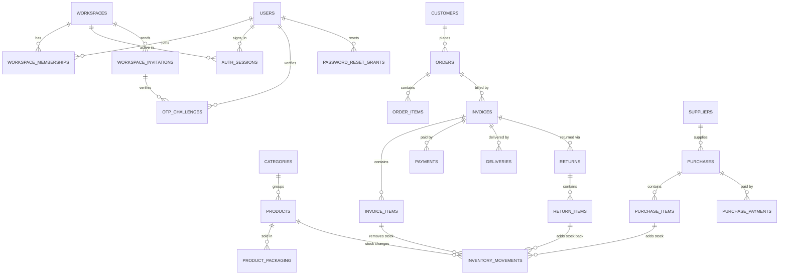

# DukaanPulse: Backend Schema

|                             |                                                                                                                                                     |
| --------------------------- | --------------------------------------------------------------------------------------------------------------------------------------------------- |
| **Product**           | DukaanPulse                                                                                                                                         |
| **Document type**     | Backend Schema: tables, columns, relationships, authentication flows, and how data is stored and organised                                          |
| **Database**          | PostgreSQL                                                                                                                                          |
| **Source of truth**   | `backend/sql/000` to `005` and `backend/app/models/`                                                                                          |
| **Related documents** | [PRD](01-PRD.md), [TRD](02-TRD.md), [App Flow](03-APP-FLOW.md), [UI/UX Brief](04-UIUX-DESIGN-BRIEF.md), [Implementation Plan](06-IMPLEMENTATION-PLAN.md) |

---

## 1. How the data is organised

### 1.1 Two kinds of tables

| Kind                          | What it holds                                                                     | Has `workspace_id`?                                                                                                                                                         |
| ----------------------------- | --------------------------------------------------------------------------------- | ----------------------------------------------------------------------------------------------------------------------------------------------------------------------------- |
| **Identity and access** | People, businesses, memberships, sessions, one-time passwords, invitations, audit | **No.** These define who belongs where. (`auth_sessions`, `workspace_invitations` and `security_audit_events` do refer to a workspace, as part of their meaning.) |
| **Business data**       | Products, customers, orders, invoices, payments, stock and so on (17 tables)      | **Yes. Every row belongs to exactly one business.**                                                                                                                     |

### 1.2 Conventions

| Topic        | Rule                                                                                                                                                  |
| ------------ | ----------------------------------------------------------------------------------------------------------------------------------------------------- |
| Primary keys | `bigint` ids named `<thing>_id` (for example `invoice_id`)                                                                                      |
| Time         | `timestamptz` for events (`created_at`); `date` for business dates (`invoice_date`, `payment_date`). Business time zone is `Asia/Kolkata` |
| Money        | `numeric(14,2)` (credit limit `numeric(12,2)`)                                                                                                    |
| Quantities   | `numeric(12,3)` on documents; `numeric(14,3)` on the stock ledger                                                                                 |
| Statuses     | `varchar` with a `CHECK` that lists the allowed values                                                                                            |
| Deleting     | Business records are **not deleted**. They are cancelled or set `INACTIVE`. Only sessions are ever deleted or revoked                         |
| Secrets      | Passwords, tokens and OTPs are stored only as **hashes**                                                                                        |
| Names        | Singular business words, snake_case. Join tables end in `_items`                                                                                    |

### 1.3 The tenant rule (how businesses stay separate)

1. Every business table has `workspace_id bigint NOT NULL` pointing to `workspaces`.
2. Every business table also has a unique key on `(workspace_id, <its id>)`. Child tables use **composite foreign keys** such as `(workspace_id, product_id)`, so a row can never point to a parent in another business.
3. Values that must be unique per business are unique on `(workspace_id, value)`: category name, product SKU, supplier GST number, invoice number, payment reference.
4. The application also adds `workspace_id = <current business>` to every query automatically (see TRD section 5).

> **Migration 005 only runs on empty business tables.** It stops with an error if any business data already exists, so apply it before real data is entered.

---

## 2. Relationship map

---

## 3. Identity and access tables

### 3.1 `users`

One row per person, across all businesses.

| Column                 | Type              | Notes                                                                                                                                      |
| ---------------------- | ----------------- | ------------------------------------------------------------------------------------------------------------------------------------------ |
| `user_id`            | bigint, PK        | identity                                                                                                                                   |
| `username`           | varchar(50)       | unique, case-insensitive (`uq_users_username_lower` on `lower(username)`)                                                              |
| `full_name`          | varchar(100)      |                                                                                                                                            |
| `password_hash`      | text              | Argon2                                                                                                                                     |
| `mobile_e164`        | varchar(16), null | unique (`uq_users_mobile_e164`); international format                                                                                    |
| `mobile_verified_at` | timestamptz, null | set when the OTP is verified                                                                                                               |
| `status`             | varchar(10)       | `ACTIVE` / `INACTIVE`                                                                                                                  |
| `failed_login_count` | integer           | wrong passwords in a row                                                                                                                   |
| `locked_until`       | timestamptz, null | login lock                                                                                                                                 |
| `last_login_at`      | timestamptz, null |                                                                                                                                            |
| `created_at`         | timestamptz       |                                                                                                                                            |
| `role`               | varchar(20)       | **Legacy.** Allowed: `ADMIN`, `SALES`, `WAREHOUSE`, `ACCOUNTS`, `VIEWER`. Real roles now live on `workspace_memberships` |
| `token_version`      | integer           | **Legacy** from the old JWT login, no longer used                                                                                    |

### 3.2 `workspaces`

One row per business.

| Column            | Type         | Notes                     |
| ----------------- | ------------ | ------------------------- |
| `workspace_id`  | bigint, PK   |                           |
| `business_name` | varchar(150) |                           |
| `status`        | varchar(20)  | `ACTIVE` / `INACTIVE` |
| `created_at`    | timestamptz  |                           |

### 3.3 `workspace_memberships`

Who belongs to which business, and in what role.

| Column            | Type                         | Notes                                                                    |
| ----------------- | ---------------------------- | ------------------------------------------------------------------------ |
| `membership_id` | bigint, PK                   |                                                                          |
| `workspace_id`  | bigint, FK → `workspaces` |                                                                          |
| `user_id`       | bigint, FK → `users`      |                                                                          |
| `role`          | varchar(20)                  | `OWNER`, `ADMIN`, `SALES`, `WAREHOUSE`, `ACCOUNTS`, `VIEWER` |
| `status`        | varchar(20)                  | `ACTIVE` / `INACTIVE`                                                |
| `created_at`    | timestamptz                  |                                                                          |

Unique: `(workspace_id, user_id)`. Index on `user_id`. One person has at most one membership per business, but can have memberships in many businesses.

### 3.4 `auth_sessions`

One row per signed-in browser session.

| Column                           | Type                | Notes                                             |
| -------------------------------- | ------------------- | ------------------------------------------------- |
| `session_id`                   | bigint, PK          |                                                   |
| `user_id`                      | bigint              |                                                   |
| `workspace_id`                 | bigint              | the business this session is working in           |
| `token_hash`                   | varchar(64), unique | HMAC of the random cookie value                   |
| `csrf_token_hash`              | varchar(64)         | HMAC of the CSRF token                            |
| `created_at`, `last_seen_at` | timestamptz         | `last_seen_at` is updated at most once a minute |
| `expires_at`                   | timestamptz         | absolute end (8 hours after login)                |
| `revoked_at`                   | timestamptz, null   | set on logout, password change, deactivation      |

A composite foreign key `(workspace_id, user_id)` → `workspace_memberships` means **a session can only exist for a real membership**. Partial index on `(user_id, expires_at)` where `revoked_at IS NULL`.

### 3.5 `otp_challenges`

One row per OTP that has been sent.

| Column                                                                 | Type             | Notes                                          |
| ---------------------------------------------------------------------- | ---------------- | ---------------------------------------------- |
| `challenge_id`                                                       | bigint, PK       |                                                |
| `public_id`                                                          | uuid, unique     | the only id shown to the browser               |
| `purpose`                                                            | varchar(30)      | `SIGNUP`, `PASSWORD_RESET`, `INVITATION` |
| `mobile_e164`                                                        | varchar(16)      | where the code was sent                        |
| `otp_hash`                                                           | varchar(64)      | HMAC of the 6-digit code                       |
| `user_id`                                                            | bigint, null, FK | for password reset                             |
| `invitation_id`                                                      | bigint, null, FK | for invitations                                |
| `pending_username`, `pending_full_name`, `pending_business_name` | varchar, null    | held until the code is verified                |
| `pending_password_hash`                                              | text, null       | the Argon2 hash chosen at signup               |
| `attempts`                                                           | integer          | `CHECK` 0 to 5                               |
| `sent_at`, `expires_at`, `consumed_at`                           | timestamptz      | valid for 5 minutes, used once                 |

Index on `(mobile_e164, purpose)`.

### 3.6 `workspace_invitations`

| Column                          | Type                    | Notes                                                                           |
| ------------------------------- | ----------------------- | ------------------------------------------------------------------------------- |
| `invitation_id`               | bigint, PK              |                                                                                 |
| `workspace_id`                | bigint, FK              |                                                                                 |
| `created_by_user_id`          | bigint, FK → `users` |                                                                                 |
| `mobile_e164`                 | varchar(16)             | the invited number                                                              |
| `role`                        | varchar(20)             | `ADMIN`, `SALES`, `WAREHOUSE`, `ACCOUNTS`, `VIEWER` (never `OWNER`) |
| `token_hash`                  | varchar(64), unique     | hash of the one-time link token                                                 |
| `expires_at`                  | timestamptz             | 7 days                                                                          |
| `accepted_at`, `revoked_at` | timestamptz, null       |                                                                                 |
| `created_at`                  | timestamptz             |                                                                                 |

Index on `(workspace_id, mobile_e164)`.

### 3.7 `password_reset_grants`

Short-lived proof that someone passed the OTP for a reset.

| Column          | Type                | Notes      |
| --------------- | ------------------- | ---------- |
| `grant_id`    | bigint, PK          |            |
| `user_id`     | bigint, FK          |            |
| `token_hash`  | varchar(64), unique |            |
| `expires_at`  | timestamptz         | 10 minutes |
| `consumed_at` | timestamptz, null   | used once  |
| `created_at`  | timestamptz         |            |

### 3.8 `security_audit_events`

An append-only log.

| Column                        | Type               | Notes                                                                |
| ----------------------------- | ------------------ | -------------------------------------------------------------------- |
| `event_id`                  | bigint, PK         |                                                                      |
| `user_id`, `workspace_id` | bigint, null, FK   |                                                                      |
| `event_type`                | varchar(60)        | for example `invitation_created`, `administrator_password_reset` |
| `detail`                    | varchar(200), null | short, never a secret                                                |
| `created_at`                | timestamptz        |                                                                      |

Indexes on `(user_id, created_at)` and `(workspace_id, created_at)`.

### 3.9 `auth_rate_limit_events`

Counts used to slow down abuse.

| Column                  | Type        | Notes                                          |
| ----------------------- | ----------- | ---------------------------------------------- |
| `rate_limit_event_id` | bigint, PK  |                                                |
| `scope`               | varchar(40) | for example IP, mobile, global                 |
| `key_hash`            | varchar(64) | hash of the IP or mobile (never the raw value) |
| `event_type`          | varchar(40) | for example OTP send, OTP verify, login        |
| `created_at`          | timestamptz |                                                |

Index on `(scope, key_hash, event_type, created_at)`. A limit is "count the rows in the time window".

---

## 4. Business tables

Every table below also has `workspace_id bigint NOT NULL` (FK → `workspaces`) and the composite keys described in section 1.3. It is left out of the column lists to keep them short.

### 4.1 Catalogue

**`categories`**

| Column            | Type         | Notes                     |
| ----------------- | ------------ | ------------------------- |
| `category_id`   | bigint, PK   |                           |
| `category_name` | varchar(100) | unique per business       |
| `status`        | varchar(20)  | `ACTIVE` / `INACTIVE` |
| `created_at`    | timestamptz  |                           |

**`products`**

| Column           | Type                         | Notes                     |
| ---------------- | ---------------------------- | ------------------------- |
| `product_id`   | bigint, PK                   |                           |
| `product_name` | varchar(200)                 |                           |
| `category_id`  | bigint, FK → `categories` |                           |
| `brand_name`   | varchar(100), null           |                           |
| `sku`          | varchar(50)                  | unique per business       |
| `status`       | varchar(20)                  | `ACTIVE` / `INACTIVE` |
| `created_at`   | timestamptz                  |                           |

**`product_packaging`** (the units a product can be bought and sold in)

| Column                                                   | Type                       | Notes                                                |
| -------------------------------------------------------- | -------------------------- | ---------------------------------------------------- |
| `packaging_id`                                         | bigint, PK                 |                                                      |
| `product_id`                                           | bigint, FK → `products` |                                                      |
| `unit_name`                                            | varchar(50)                | for example Piece, Box, Carton                       |
| `conversion_to_base`                                   | numeric(12,4)              | `> 0`. How many base units are in one of this unit |
| `is_base_unit`, `is_purchase_unit`, `is_sale_unit` | boolean                    | which role this unit plays                           |

Unique `(workspace_id, product_id, packaging_id)`, so documents can point at a packaging that **belongs to that product**.

### 4.2 People

**`customers`**

| Column                 | Type              | Notes                                                                                                                     |
| ---------------------- | ----------------- | ------------------------------------------------------------------------------------------------------------------------- |
| `customer_id`        | bigint, PK        |                                                                                                                           |
| `customer_name`      | varchar(150)      |                                                                                                                           |
| `phone`              | varchar(20), null |                                                                                                                           |
| `address`            | text              |                                                                                                                           |
| `area`               | varchar(100)      |                                                                                                                           |
| `credit_limit`       | numeric(12,2)     | `>= 0`                                                                                                                  |
| `payment_terms_days` | integer           | `>= 0`. Days allowed to pay after the invoice date                                                                      |
| `credit_balance`     | numeric(14,2)     | `>= 0`. Money the business owes this customer (from returns). **Stored, and changed by returns and Apply credit** |
| `status`             | varchar(20)       | `ACTIVE` / `INACTIVE`                                                                                                 |
| `created_at`         | timestamptz       |                                                                                                                           |

**`suppliers`**

| Column                 | Type              | Notes                                                               |
| ---------------------- | ----------------- | ------------------------------------------------------------------- |
| `supplier_id`        | bigint, PK        |                                                                     |
| `supplier_name`      | varchar(150)      |                                                                     |
| `phone`              | varchar(20), null |                                                                     |
| `address`            | text              |                                                                     |
| `gst_number`         | varchar(15), null | `CHECK` against the 15-character GST pattern; unique per business |
| `payment_terms_days` | integer           | `>= 0`                                                            |
| `status`             | varchar(20)       |                                                                     |
| `created_at`         | timestamptz       |                                                                     |

### 4.3 Buying

**`purchases`**

| Column                                                | Type                        | Notes                                                            |
| ----------------------------------------------------- | --------------------------- | ---------------------------------------------------------------- |
| `purchase_id`                                       | bigint, PK                  |                                                                  |
| `supplier_id`                                       | bigint, FK → `suppliers` |                                                                  |
| `purchase_date`                                     | date                        |                                                                  |
| `supplier_invoice_no`                               | varchar(100)                |                                                                  |
| `subtotal`, `discount`, `tax`, `total_amount` | numeric(14,2)               | each `>= 0`                                                    |
| `status`                                            | varchar(30)                 | `PENDING`, `PARTIALLY_RECEIVED`, `RECEIVED`, `CANCELLED` |
| `created_at`                                        | timestamptz                 |                                                                  |

**`purchase_items`**

| Column                                                | Type          | Notes                                |
| ----------------------------------------------------- | ------------- | ------------------------------------ |
| `purchase_item_id`                                  | bigint, PK    |                                      |
| `purchase_id`, `product_id`, `packaging_id`     | bigint, FK    |                                      |
| `quantity`                                          | numeric(12,3) | `> 0`                              |
| `received_quantity`                                 | numeric(12,3) | `CHECK` between 0 and `quantity` |
| `unit_price`, `discount`, `tax`, `line_total` | numeric(14,2) | `>= 0`                             |

**`purchase_payments`**

| Column                          | Type                     | Notes                                            |
| ------------------------------- | ------------------------ | ------------------------------------------------ |
| `purchase_payment_id`         | bigint, PK               |                                                  |
| `purchase_id`                 | bigint, FK               |                                                  |
| `payment_date`                | date                     |                                                  |
| `amount`                      | numeric(14,2)            | `> 0`                                          |
| `payment_method`              | varchar(30)              | `CASH`, `UPI`, `BANK_TRANSFER`, `CHEQUE` |
| `reference_number`, `notes` | varchar(100), text, null |                                                  |
| `created_at`                  | timestamptz              |                                                  |

### 4.4 Selling

**`orders`**

| Column          | Type                        | Notes                                                                             |
| --------------- | --------------------------- | --------------------------------------------------------------------------------- |
| `order_id`    | bigint, PK                  |                                                                                   |
| `customer_id` | bigint, FK → `customers` |                                                                                   |
| `order_date`  | date                        |                                                                                   |
| `status`      | varchar(30)                 | `PENDING`, `CONFIRMED`, `PARTIALLY_FULFILLED`, `COMPLETED`, `CANCELLED` |
| `notes`       | text, null                  |                                                                                   |
| `created_at`  | timestamptz                 |                                                                                   |

**`order_items`**

| Column                                         | Type          | Notes   |
| ---------------------------------------------- | ------------- | ------- |
| `order_item_id`                              | bigint, PK    |         |
| `order_id`, `product_id`, `packaging_id` | bigint, FK    |         |
| `quantity`                                   | numeric(12,3) | `> 0` |

**`invoices`**

| Column                                                | Type                     | Notes                                                   |
| ----------------------------------------------------- | ------------------------ | ------------------------------------------------------- |
| `invoice_id`                                        | bigint, PK               |                                                         |
| `order_id`                                          | bigint, FK → `orders` | one order can have several invoices (partial billing)   |
| `invoice_number`                                    | varchar(100)             | unique per business                                     |
| `invoice_date`                                      | date                     |                                                         |
| `subtotal`, `discount`, `tax`, `total_amount` | numeric(14,2)            | each `>= 0`                                           |
| `status`                                            | varchar(30)              | `UNPAID`, `PARTIALLY_PAID`, `PAID`, `CANCELLED` |
| `created_at`                                        | timestamptz              |                                                         |

**`invoice_items`**

| Column                                                | Type          | Notes                                                             |
| ----------------------------------------------------- | ------------- | ----------------------------------------------------------------- |
| `invoice_item_id`                                   | bigint, PK    |                                                                   |
| `invoice_id`, `product_id`, `packaging_id`      | bigint, FK    |                                                                   |
| `quantity`                                          | numeric(12,3) | `> 0`                                                           |
| `unit_price`, `discount`, `tax`, `line_total` | numeric(14,2) | `>= 0`. `line_total = quantity x unit_price - discount + tax` |

**`deliveries`**

| Column                                         | Type                                  | Notes                                                                                       |
| ---------------------------------------------- | ------------------------------------- | ------------------------------------------------------------------------------------------- |
| `delivery_id`                                | bigint, PK                            |                                                                                             |
| `invoice_id`                                 | bigint, FK → `invoices`            |                                                                                             |
| `delivery_date`                              | date, null                            |                                                                                             |
| `status`                                     | varchar(30)                           | `PENDING`, `DISPATCHED`, `OUT_FOR_DELIVERY`, `DELIVERED`, `FAILED`, `CANCELLED` |
| `delivery_address`                           | text                                  |                                                                                             |
| `vehicle_number`, `driver_name`, `notes` | varchar(30), varchar(100), text, null |                                                                                             |
| `created_at`                                 | timestamptz                           |                                                                                             |

**`payments`** (customer payments)

| Column               | Type                       | Notes                                                                                                      |
| -------------------- | -------------------------- | ---------------------------------------------------------------------------------------------------------- |
| `payment_id`       | bigint, PK                 |                                                                                                            |
| `invoice_id`       | bigint, FK → `invoices` |                                                                                                            |
| `payment_date`     | date                       | the day the money really arrived                                                                           |
| `amount`           | numeric(14,2)              | `> 0`                                                                                                    |
| `payment_method`   | varchar(30)                | `CASH`, `UPI`, `BANK_TRANSFER`, `CHEQUE`, and system methods `RETURN_CREDIT`, `CREDIT_APPLIED` |
| `reference_number` | varchar(100), null         | unique per business                                                                                        |
| `notes`            | text, null                 |                                                                                                            |
| `created_at`       | timestamptz                |                                                                                                            |

**`returns`**

| Column          | Type                       | Notes                                                                                          |
| --------------- | -------------------------- | ---------------------------------------------------------------------------------------------- |
| `return_id`   | bigint, PK                 |                                                                                                |
| `invoice_id`  | bigint, FK → `invoices` |                                                                                                |
| `return_date` | date                       |                                                                                                |
| `reason`      | varchar(30)                | `DAMAGED`, `EXPIRED`, `WRONG_PRODUCT`, `QUALITY_ISSUE`, `EXCESS_QUANTITY`, `OTHER` |
| `status`      | varchar(30)                | `REQUESTED`, `APPROVED`, `RECEIVED`, `REJECTED`, `CANCELLED`                         |
| `notes`       | text, null                 |                                                                                                |
| `created_at`  | timestamptz                |                                                                                                |

**`return_items`**

| Column                                          | Type          | Notes                                                         |
| ----------------------------------------------- | ------------- | ------------------------------------------------------------- |
| `return_item_id`                              | bigint, PK    |                                                               |
| `return_id`, `product_id`, `packaging_id` | bigint, FK    |                                                               |
| `quantity`                                    | numeric(12,3) | `> 0`                                                       |
| `condition`                                   | varchar(30)   | `RESELLABLE`, `DAMAGED`, `EXPIRED`, `SUPPLIER_RETURN` |

### 4.5 Stock ledger

**`inventory_movements`** (append-only)

| Column               | Type                       | Notes                                                                                    |
| -------------------- | -------------------------- | ---------------------------------------------------------------------------------------- |
| `movement_id`      | bigint, PK                 |                                                                                          |
| `product_id`       | bigint, FK → `products` |                                                                                          |
| `base_quantity`    | numeric(14,3)              | `<> 0`. **Positive adds stock, negative removes it**, in the product's base unit |
| `movement_type`    | varchar(30)                | `OPENING`, `PURCHASE`, `SALE`, `RETURN`, `DAMAGE`, `ADJUSTMENT`              |
| `movement_date`    | timestamptz                |                                                                                          |
| `purchase_item_id` | bigint, null, FK           | set for `PURCHASE`                                                                     |
| `invoice_item_id`  | bigint, null, FK           | set for `SALE`                                                                         |
| `return_item_id`   | bigint, null, FK           | set for `RETURN`                                                                       |
| `notes`            | text, null                 |                                                                                          |
| `created_at`       | timestamptz                |                                                                                          |

A database `CHECK` (`chk_inventory_reference`) makes each type point at **the right one source** and no other. For example a `PURCHASE` must reference a purchase item and nothing else. This is how every stock number stays explainable.

---

## 5. Allowed values (reference)

| Where                                                                                      | Values                                                                                         |
| ------------------------------------------------------------------------------------------ | ---------------------------------------------------------------------------------------------- |
| Membership role                                                                            | `OWNER`, `ADMIN`, `SALES`, `WAREHOUSE`, `ACCOUNTS`, `VIEWER`                       |
| Invitation role                                                                            | all of the above except `OWNER`                                                              |
| Record status (categories, products, customers, suppliers, workspaces, memberships, users) | `ACTIVE`, `INACTIVE`                                                                       |
| Order                                                                                      | `PENDING`, `CONFIRMED`, `PARTIALLY_FULFILLED`, `COMPLETED`, `CANCELLED`              |
| Invoice                                                                                    | `UNPAID`, `PARTIALLY_PAID`, `PAID`, `CANCELLED`                                        |
| Delivery                                                                                   | `PENDING`, `DISPATCHED`, `OUT_FOR_DELIVERY`, `DELIVERED`, `FAILED`, `CANCELLED`    |
| Purchase                                                                                   | `PENDING`, `PARTIALLY_RECEIVED`, `RECEIVED`, `CANCELLED`                               |
| Return                                                                                     | `REQUESTED`, `APPROVED`, `RECEIVED`, `REJECTED`, `CANCELLED`                         |
| Return reason                                                                              | `DAMAGED`, `EXPIRED`, `WRONG_PRODUCT`, `QUALITY_ISSUE`, `EXCESS_QUANTITY`, `OTHER` |
| Return condition                                                                           | `RESELLABLE`, `DAMAGED`, `EXPIRED`, `SUPPLIER_RETURN`                                  |
| Customer payment method                                                                    | `CASH`, `UPI`, `BANK_TRANSFER`, `CHEQUE`, `RETURN_CREDIT`, `CREDIT_APPLIED`        |
| Supplier payment method                                                                    | `CASH`, `UPI`, `BANK_TRANSFER`, `CHEQUE`                                               |
| Stock movement                                                                             | `OPENING`, `PURCHASE`, `SALE`, `RETURN`, `DAMAGE`, `ADJUSTMENT`                    |
| OTP purpose                                                                                | `SIGNUP`, `PASSWORD_RESET`, `INVITATION`                                                 |

---

## 6. Stored versus worked out

Some numbers are **stored**, others are **worked out from records each time**. Worked-out numbers cannot drift out of step.

| Number                                                                | Stored or worked out                                         | How                                                                                                        |
| --------------------------------------------------------------------- | ------------------------------------------------------------ | ---------------------------------------------------------------------------------------------------------- |
| **Current stock** of a product                                  | Worked out                                                   | `SUM(inventory_movements.base_quantity)` for the product                                                 |
| **Invoice status** (`UNPAID` / `PARTIALLY_PAID` / `PAID`) | Stored, **recalculated** after every payment           | Compare `SUM(payments.amount)` with `total_amount`                                                     |
| **Order status** `PARTIALLY_FULFILLED` / `COMPLETED`        | Stored, **recalculated** after invoicing or cancelling | Compare invoiced quantity with ordered quantity per line                                                   |
| **Amount still unpaid on an invoice**                           | Worked out                                                   | `total_amount - SUM(payments.amount)` (cancelled invoices excluded)                                      |
| **Due date** of an invoice                                      | Worked out                                                   | `invoice_date + customer.payment_terms_days`                                                             |
| **Overdue amount, aging bucket**                                | Worked out                                                   | Unpaid amount grouped by days past the due date                                                            |
| **Customer risk score, band, trend, suggested limit**           | Worked out, never stored                                     | Analytics engine over the last 180 days                                                                    |
| **Five-week cash outlook**                                      | Worked out, never stored                                     | Open invoices and supplier dues placed in weekly buckets                                                   |
| **Purchase amount still payable**                               | Worked out                                                   | `total_amount - SUM(purchase_payments.amount)`                                                           |
| **`customers.credit_balance`**                                | **Stored**                                             | Raised when a return exceeds the unpaid invoice balance; lowered by Apply credit. Changed under a row lock |
| **`purchase_items.received_quantity`**                        | **Stored**                                             | Raised when goods are received                                                                             |

---

## 7. Authentication and data flows

Each flow lists the tables it reads and writes.

### 7.1 Signup

1. `POST /auth/signup` with name, business name, mobile, username and password (12+ characters).
2. Check rate limits (`auth_rate_limit_events`) and that the username and mobile are free (`users`).
3. Hash the password (Argon2). **Insert** an `otp_challenges` row: purpose `SIGNUP`, `otp_hash`, the `pending_*` fields, 5-minute expiry. Send the SMS. Return the challenge's `public_id`.
4. `POST /auth/signup/verify-otp` with the `public_id` and code. Lock the challenge row, check expiry, attempts (max 5) and the code hash.
5. In **one transaction**: insert `users` (mobile verified), `workspaces`, `workspace_memberships` (role `OWNER`); mark the challenge consumed; create a session (7.3); write an audit event.
6. Set the session and CSRF cookies. The browser is signed in.

### 7.2 Login

1. `POST /auth/login` with username or mobile, and password. Check rate limits.
2. Find the user. Unknown user: do a dummy password check so the timing is the same.
3. If `locked_until` is in the future: refuse.
4. Wrong password: `failed_login_count` + 1. At 5, set `locked_until` (15 minutes).
5. Right password: reset the counters, set `last_login_at`, **revoke the user's other sessions**, pick the first `ACTIVE` membership of an `ACTIVE` workspace, create a session, write an audit event.

### 7.3 Creating a session

Generate two random values: a session token and a CSRF token. Store only their **HMAC hashes** in `auth_sessions` with a workspace, an expiry (8 hours) and `last_seen_at`. Send the session token as an **HttpOnly** cookie and the CSRF token as a readable cookie.

### 7.4 Checking a session on every request

1. Read the session cookie, hash it, find the row in `auth_sessions`.
2. Reject if revoked, past `expires_at`, or idle for more than 30 minutes since `last_seen_at`.
3. Load the user (must be `ACTIVE`) and the membership for the **session's workspace** (must be `ACTIVE`).
4. For `POST`, `PATCH` and `DELETE`: the `X-CSRF-Token` header must match the stored hash.
5. Check the permission for the route against the membership's role.
6. Bind the request to that workspace. Update `last_seen_at` only if it is over a minute old.

### 7.5 Logout, expiry, deactivation

- **Logout:** set `revoked_at` on the session and clear the cookies.
- **Idle or absolute timeout:** the next request is refused (`401`).
- **Deactivating a member** or **changing a password:** the user's sessions are revoked.

### 7.6 Switching business

Confirm the user has an `ACTIVE` membership in the target workspace. **Revoke** the current session and create a **new** one for the target workspace.

### 7.7 Forgot and reset password

1. `POST /auth/forgot-password` with a mobile number. The answer is always the same, whether or not the number exists.
2. If it exists: insert an `otp_challenges` row (`PASSWORD_RESET`) and send the code.
3. `POST /auth/reset-password/verify-otp`: on success, insert a `password_reset_grants` row (10 minutes) and return its token once.
4. `POST /auth/reset-password` with the token and a new password: consume the grant (`consumed_at`), store the new hash, **revoke all sessions**, write an audit event.

### 7.8 Inviting a staff member

1. Owner or Admin (`users:manage`) calls `POST /business/invitations` with a mobile number and role. Insert `workspace_invitations` (hash of a random token, 7-day expiry). The raw token is returned **once**, as part of the link.
2. The invited person opens the link: `POST /business/invitations/accept`.
   - **New person:** validate name, username, password; store them in `otp_challenges.pending_*`.
   - **Existing person:** the **current password must be correct** (with the same lockout as login).
   - Send an OTP to the invited number.
3. `POST /business/invitations/verify-otp`: in one transaction create the user if needed, create or reactivate the membership with the invited role, mark the invitation `accepted_at`, create a session, write an audit event.

### 7.9 Managing people

- `PATCH /users/{id}`: change role or status. Nobody changes their own role; ownership cannot be handed out here; the last active Owner cannot be demoted or deactivated.
- `POST /users/{id}/reset-password`: Owner only, and only for a person who belongs to **no other** workspace. Revokes that person's sessions.
- `GET /auth/sessions`, `DELETE /auth/sessions/{id}`: list and revoke one's own sessions.

### 7.10 What is hashed, and with what

| Value                         | How it is stored                                                                                     |
| ----------------------------- | ---------------------------------------------------------------------------------------------------- |
| Password                      | Argon2 hash in `users.password_hash` (and `otp_challenges.pending_password_hash` until verified) |
| Session token                 | HMAC with `SESSION_TOKEN_PEPPER` in `auth_sessions.token_hash`                                   |
| CSRF token                    | HMAC in `auth_sessions.csrf_token_hash`                                                            |
| OTP code                      | HMAC with `OTP_HMAC_KEY` in `otp_challenges.otp_hash`                                            |
| Invitation and reset tokens   | Hash in `token_hash` columns                                                                       |
| IP and mobile for rate limits | Hash in `auth_rate_limit_events.key_hash`                                                          |

---

## 8. How the main business flows touch the data

| Flow                                | Rows written                                                                                                                                 | Key rules                                                                                                           |
| ----------------------------------- | -------------------------------------------------------------------------------------------------------------------------------------------- | ------------------------------------------------------------------------------------------------------------------- |
| **Receive a purchase**        | `purchase_items.received_quantity`, `purchases.status`, **`inventory_movements` (`PURCHASE`, positive)**                       | Received quantity cannot exceed ordered quantity                                                                    |
| **Create an invoice**         | `invoices`, `invoice_items`; order status recalculated                                                                                   | Billed quantity per product cannot exceed ordered quantity; totals must match lines; starts `UNPAID`              |
| **Mark a delivery delivered** | `deliveries.status`, **`inventory_movements` (`SALE`, negative)**                                                                | Locks the product, refuses if stock is short                                                                        |
| **Record a payment**          | `payments`; invoice status recalculated                                                                                                    | Locks the invoice; amount cannot exceed what is unpaid; not on a cancelled invoice                                  |
| **Apply customer credit**     | `payments` (`CREDIT_APPLIED`), `customers.credit_balance`                                                                              | Locks the customer row; unique reference each time                                                                  |
| **Receive a return**          | `returns.status`, **`inventory_movements` (`RETURN`, positive)**, `payments` (`RETURN_CREDIT`), `customers.credit_balance` | Locks the return row so it can only be received once; credit uses the invoice line value including discount and tax |
| **Record a supplier payment** | `purchase_payments`                                                                                                                        | Cannot exceed the amount still payable                                                                              |

---

## 9. API endpoints and required permission

All business routes require a signed-in session, a CSRF token on writes, and the permission shown.

### 9.1 Identity and access

| Method    | Path                                                                                     | Permission                                                    |
| --------- | ---------------------------------------------------------------------------------------- | ------------------------------------------------------------- |
| POST      | `/auth/signup`, `/auth/signup/resend-otp`, `/auth/signup/verify-otp`               | public                                                        |
| POST      | `/auth/otp/resend`                                                                     | public                                                        |
| POST      | `/auth/login`                                                                          | public                                                        |
| POST      | `/auth/forgot-password`, `/auth/reset-password/verify-otp`, `/auth/reset-password` | public                                                        |
| POST      | `/business/invitations/accept`, `/business/invitations/verify-otp`                   | public (invitation token)                                     |
| POST      | `/business/invitations`                                                                | `users:manage`                                              |
| GET       | `/auth/me`, `/auth/sessions`                                                         | any signed-in user                                            |
| POST      | `/auth/logout`, `/auth/switch-workspace`, `/auth/change-password`                  | any signed-in user                                            |
| DELETE    | `/auth/sessions/{session_id}`                                                          | any signed-in user                                            |
| GET, POST | `/users`                                                                               | `users:manage` (POST directs people to the invitation flow) |
| PATCH     | `/users/{user_id}`                                                                     | `users:manage`                                              |
| POST      | `/users/{user_id}/reset-password`                                                      | `users:manage` and the Owner role                           |

### 9.2 Business data

| Area              | Method and path                                                                                                                   | Permission                                                                          |
| ----------------- | --------------------------------------------------------------------------------------------------------------------------------- | ----------------------------------------------------------------------------------- |
| Categories        | GET `/categories/` · POST `/categories/`                                                                                     | `categories:read` · `categories:write`                                         |
| Products          | GET `/products/`, `/products/{id}` · POST `/products/` · PATCH `/products/{id}`                                         | `products:read` · `products:write`                                             |
| Customers         | GET `/customers/`, `/customers/{id}` · POST `/customers/` · PATCH `/customers/{id}`                                     | `customers:read` · `customers:write`                                           |
| Suppliers         | GET `/suppliers/`, `/suppliers/{id}` · POST `/suppliers/` · PATCH `/suppliers/{id}`                                     | `suppliers:read` · `suppliers:write`                                           |
| Purchases         | GET `/purchases/`, `/purchases/{id}` · POST `/purchases/` · PATCH `/purchases/{id}/status`, `/purchases/{id}/receive` | `purchases:read` · `purchases:write`                                           |
| Supplier payments | GET `/purchase-payments/` · POST `/purchase-payments/`                                                                       | `purchase_payments:read` · `purchase_payments:write`                           |
| Orders            | GET `/orders/`, `/orders/{id}` · POST `/orders/` · PATCH `/orders/{id}/status`                                          | `orders:read` · `orders:write`                                                 |
| Invoices          | GET `/invoices/`, `/invoices/{id}` · POST `/invoices/` · PATCH `/invoices/{id}/status`                                  | `invoices:read` · `invoices:write`                                             |
| Deliveries        | GET `/deliveries/` · POST `/deliveries/` · PATCH `/deliveries/{id}/status`                                                | `deliveries:read` · `deliveries:write`                                         |
| Customer payments | GET `/payments/` · POST `/payments/`, `/payments/apply-credit`                                                             | `payments:read` · `payments:write`                                             |
| Returns           | GET `/returns/`, `/returns/{id}` · POST `/returns/` · PATCH `/returns/{id}/approve` · PATCH `/returns/{id}/receive`  | `returns:read` · `returns:write` · `returns:approve` · `returns:receive` |
| Stock             | GET `/inventory/stock/{product_id}`                                                                                             | `inventory:read`                                                                  |
| Dashboard         | GET `/dashboard/summary`, `/sales`, `/sales/daily`, `/purchases`, `/top-products`, `/low-stock`, `/payment-summary` | `dashboard:read`                                                                  |
| Reports           | GET `/reports/receivables`, `/reports/customer-risk`, `/reports/cash-flow`                                                  | `reports:read`                                                                    |

In total there are 72 routes. A test (`test_route_audit`) fails if a route is added without a permission decision.

---

## 10. Migrations

Run in order, each once:

| File                                      | What it does                                                                                                                                       |
| ----------------------------------------- | -------------------------------------------------------------------------------------------------------------------------------------------------- |
| `000_baseline_schema.sql`               | The 17 business tables, with their statuses, quantity and money checks                                                                             |
| `001_create_users.sql`                  | `users` and the case-insensitive unique username                                                                                                 |
| `002_add_user_token_version.sql`        | `token_version` (legacy)                                                                                                                         |
| `003_add_login_lockout.sql`             | `failed_login_count`, `locked_until`                                                                                                           |
| `004_auth_workspace_foundation.sql`     | Mobile number on users; `workspaces`, memberships, invitations, OTP challenges, reset grants, sessions, audit events, rate-limit events; indexes |
| `005_workspace_scope_business_data.sql` | `workspace_id` on every business table; per-business unique keys; composite foreign keys. **Fails if business tables already hold data.**  |

---

## 11. Rules the schema enforces by itself

Even if application code has a bug, the database refuses:

- negative money, zero or negative quantities, and a payment of zero or less;
- a received quantity above the ordered quantity;
- an unknown status, payment method, reason or condition;
- a stock movement of zero, or one that does not point at its single correct source;
- a child row that points at a parent from another business;
- duplicate SKU, invoice number, payment reference, GST number or category name **within one business**;
- a session for a person who is not a member of that business;
- more than 5 wrong attempts on one OTP;
- an invalid GST number format.

**Not enforced by the database** (done in application code under locks): that a payment fits the unpaid balance, that billed quantity fits the order, that stock is enough for a sale, and that a return fits what was sold.
