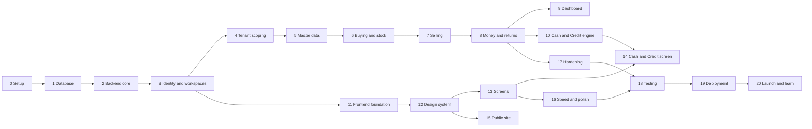

# DukaanPulse: Implementation Plan

|                             |                                                                                                                                           |
| --------------------------- | ----------------------------------------------------------------------------------------------------------------------------------------- |
| **Product**           | DukaanPulse                                                                                                                               |
| **Document type**     | Implementation Plan: the order in which to build the product, step by step                                                                |
| **Related documents** | [PRD](01-PRD.md), [TRD](02-TRD.md), [App Flow](03-APP-FLOW.md), [UI/UX Brief](04-UIUX-DESIGN-BRIEF.md), [Backend Schema](05-BACKEND-SCHEMA.md) |

---

## 1. How to read this plan

The product is **largely built already**. This plan does two jobs:

1. It records the **build sequence**: the order in which things must be made, because each step depends on the one before. Anyone rebuilding or extending the product can follow it.
2. It shows the **current state** of each phase, and what is still open.

| Mark | Meaning                                    |
| ---- | ------------------------------------------ |
| ✅   | Built in the repository                    |
| 🔧   | Built, with known gaps listed in the phase |
| ⬜   | Not started                                |

> The status marks come from reading the code. Run the checks in section 4 on your own copy before trusting any mark, especially for the items marked "review fix".

### Effort sizes

**S** = about a day or less. **M** = a few days. **L** = a week or more.

---

## 2. Build order at a glance

**The rule behind the order:** data model first, identity before data, tenant safety before any business table is used, stock before sales, sales before money, money before insights.

---

## 3. Phases

### Phase 0: Setup ✅ (S)

**Goal:** Everyone can run the project on their own machine.

Steps

1. Install Python 3, Node.js 18+, PostgreSQL.
2. Create a database and put its connection string in `backend/.env` as `DATABASE_URL`.
3. Create a Python virtual environment and install `backend/requirements.txt` (and `requirements-dev.txt` for tests).
4. In `frontend/`, run `npm install`.
5. Set the development values in `backend/.env`: `ENVIRONMENT=development`, `SMS_PROVIDER=console` (the OTP prints in the backend terminal), `SESSION_TOKEN_PEPPER`, `OTP_HMAC_KEY`, `CORS_ALLOWED_ORIGINS`.

**Done when:** the backend starts with `uvicorn app.main:app --reload`, the frontend starts with `npm run dev`, and `GET /health` answers.

---

### Phase 1: Database foundation ✅ (M)

**Goal:** The tables exist and the database itself protects the data.

Steps

1. Run `sql/000_baseline_schema.sql`: 17 business tables with their money, quantity and status checks.
2. Run `001_create_users.sql`, `002_add_user_token_version.sql`, `003_add_login_lockout.sql`.
3. **Do not run 005 yet** (see phase 4). Migration 004 comes in phase 3.

**Done when:** every table in [Backend Schema](05-BACKEND-SCHEMA.md) section 4 exists and inserting a negative price is refused by the database.

---

### Phase 2: Backend core ✅ (M)

**Goal:** The skeleton every feature plugs into.

Steps

1. `core/config.py`: settings from `.env`, with strict checks in production.
2. `db/database.py`: engine, session per request.
3. `core/security.py`: Argon2 password hashing, HMAC helpers for tokens and OTPs.
4. `core/roles.py`, `core/permissions.py`: the role list and the permission table.
5. `main.py`: app, CORS, health route, router registration.
6. A **route-audit test** that fails if any route has no permission decision.

**Done when:** an unauthenticated call to a protected route returns `401`, and a test proves every route is guarded.

---

### Phase 3: Identity and workspaces ✅ (L)

**Goal:** People can sign up, log in, join a business, and be controlled by role.

Steps

1. Run `004_auth_workspace_foundation.sql`.
2. Models: users, workspaces, memberships, sessions, OTP challenges, invitations, reset grants, audit and rate-limit events.
3. `services/sms_provider.py`: a provider interface with `console` and generic HTTP versions.
4. `services/auth_lifecycle.py`: rate limits, OTP issue and verify, sessions, audit.
5. Routes in order: **signup + verify OTP** → **login/logout/me** → **session cookie, CSRF and permission guards** → **forgot/reset password** → **change password** → **switch workspace** → **sessions list/revoke** → **invitations** → **user management**.
6. Tests: login, lockout, OTP limits, invitation, permissions, security.

**Done when:** a new owner can sign up with an OTP, invite a Sales person, and that person can log in but is refused a Users route.

🔧 Known gaps (see TRD section 16): per-account lockout can be used to annoy a user; OTP can be sent to any country's number; sign-up and forgot-password reveal whether an account exists (conflict message, timing).

---

### Phase 4: Tenant scoping ✅ (M)

**Goal:** One business can never see another business's data.

Steps

1. Add the `WorkspaceScoped` model base and the query hook that filters every ORM `SELECT` by the active workspace.
2. Run `005_workspace_scope_business_data.sql` **while the business tables are still empty**. It adds `workspace_id`, per-business unique keys and composite foreign keys.
3. Make the request dependency set the active workspace from the session.
4. Write a test that creates two businesses and proves each cannot read the other's rows.

**Done when:** that test passes, and inserting a child row that points at another business's parent fails in the database.

🔧 Known gap: the filter covers ORM SELECTs only; there is no row-level security as a second wall.

---

### Phase 5: Master data ✅ (M)

**Goal:** The things everything else refers to.

Steps (each: model, schema, router, permission, test)

1. **Categories** (list, create).
2. **Products with packaging units** (list, create, read, update; base, purchase and sale unit flags; conversion to base).
3. **Customers** (credit limit, payment terms, credit balance).
4. **Suppliers** (GST number check, payment terms).

**Done when:** a product with a Box (12 pieces) and a Piece unit can be created, and a duplicate SKU in the same business is refused while the same SKU in another business is allowed.

---

### Phase 6: Buying and stock ✅ (L)

**Goal:** Stock goes up when goods arrive, and every change is explainable.

Steps

1. **`inventory_movements` ledger** and the stock check function (`SUM`).
2. **Purchases**: create with items, view, change status.
3. **Receive**: record received quantity per item, create `PURCHASE` movements, set `PARTIALLY_RECEIVED` or `RECEIVED`.
4. **Stock lookup** route.

**Done when:** receiving 10 Boxes of a 12-piece product raises stock by 120 base units, and the movement points at its purchase item.

---

### Phase 7: Selling ✅ (L)

**Goal:** From a customer's order to goods at the door.

Steps

1. **Orders**: create with items; status moves `PENDING` → `CONFIRMED` → `COMPLETED`, or `CANCELLED`.
2. **Invoices**: only from `CONFIRMED` or `PARTIALLY_FULFILLED` orders; partial billing; billed quantity limited to ordered quantity; line and invoice totals checked; always created `UNPAID`; unique invoice number per business; cancel an unpaid invoice with no active delivery.
3. **Deliveries**: create for an invoice; allowed status moves; **at `DELIVERED`, lock the product, check stock and create the `SALE` movement.**

**Done when:** delivering more than the stock is refused, and cancelling an invoice frees its quantity back onto the order.

🔧 Known gaps: delivery status changes have **no row lock** (two simultaneous "Delivered" clicks could double-deduct); **unit price and discount are accepted from the client** instead of coming from the product.

---

### Phase 8: Money and returns ✅ (L)

**Goal:** Payments, credit and returns that always add up.

Steps

1. **Customer payments**: amount limited to the unpaid balance (under a lock); invoice status recalculated; refused on a cancelled invoice.
2. **Apply credit**: uses the customer's stored credit on an invoice; locks the customer row; unique reference for each use.
3. **Returns**: create (limited to sold minus already returned), approve, receive.
4. **Receive a return** in one transaction: lock the return, add the `RETURN` stock movement, credit the invoice (value including discount and tax), put any remainder into the customer's credit balance.
5. **Supplier payments**: limited to the amount still payable.

**Done when:** receiving the same return twice has no second effect, and applying credit twice cannot spend more than the balance.

🔧 Known gaps: money is handled as floating-point in Python (the database is exact); the advisory lock keys are raw ids shared across businesses and record types.

---

### Phase 9: Dashboard ✅ (S)

**Goal:** A quick picture of the business.

Steps: summary figures, sales and purchases by month, daily sales, top products, low stock, payment summary.

**Done when:** each figure matches a manual count on the demo data.

---

### Phase 10: Cash & Credit engine ✅ (L)

**Goal:** Turn recorded data into decisions, without ever changing data.

Steps

1. `analytics/config.py`: every threshold in one place.
2. `analytics/calculations.py`: **pure functions** first, with tests before any route: aging buckets, risk score and band, trend, suggested credit limit, five-week cash projection (normal and cautious).
3. `analytics/loaders.py`: read invoices, payments, returns and supplier dues.
4. Routes: `/reports/receivables`, `/reports/customer-risk`, `/reports/cash-flow` (permission `reports:read`).
5. `scripts/seed_demo.py` and `demo_personas.py`: synthetic customers with different payment habits, to see every band.

**Done when:** on the demo data, "Reliable Retailers" is Reliable, "Chronic Late Stores" is High risk, "Newly Opened Shop" is Too new to rate, and the cash outlook shows a shortage in some week.

---

### Phase 11: Frontend foundation ✅ (M)

**Goal:** An empty but secure app shell.

Steps

1. Vite + React 18, React Router.
2. `api/client.js`: Axios with cookies, the CSRF header on writes, error message helper, 401 handling.
3. `auth/AuthProvider.jsx`: current user, login, logout, switch workspace, `can(permission)`.
4. `ProtectedRoute`, `Layout`, `ErrorBoundary`, toasts, confirm and modal components.
5. Route map from [App Flow](03-APP-FLOW.md).

**Done when:** logging in shows an empty dashboard inside the layout, and logging out returns to login.

---

### Phase 12: Design system ✅ (M)

**Goal:** One look, defined once.

Steps

1. Create the logo mark, favicon and wordmark.
2. `tokens.css`: colour scales (primary, neutral, success, warning, error), type, spacing, radius, elevation, control sizes, motion.
3. `index.css`: components built from tokens only: buttons, inputs, switch, chips, badges, cards, tables, modal and bottom sheet, toast, form banner, empty state.
4. Skeleton components and shimmer.
5. Motion rules and reduced-motion support.

**Done when:** a search of the CSS finds no hard-coded colour, spacing or radius outside the token files, and the checklist in [UI/UX Brief](04-UIUX-DESIGN-BRIEF.md) section 13 passes.

---

### Phase 13: Screens ✅ (L)

**Goal:** One working screen per module, in the same order as the backend.

Order: Products and Customers and Suppliers → Purchases → Orders → Invoices and Invoice detail → Deliveries → Customer payments and Supplier payments → Returns → Stock lookup → Dashboard → Users.

Each screen: list with search and filters, create or edit in a modal, loading skeleton, empty state, error banner, permission-aware buttons.

**Done when:** the whole journey J5 to J7 in [App Flow](03-APP-FLOW.md) can be done in the browser.

🔧 Known gap: list screens load everything (no pagination), which will slow down as data grows.

---

### Phase 14: Cash & Credit screen ✅ (M)

**Goal:** A screen anyone can understand.

Steps, in this order (see [UI/UX Brief](04-UIUX-DESIGN-BRIEF.md) section 8.7)

1. Summary card with the answer sentence.
2. "Who needs attention" with plain sentences and suggested actions.
3. "How late is the money?" bars.
4. "All customers" with filter chips, a risk meter and a "Why?" breakdown.
5. "Will you have enough cash?" with the cautious switch and week cards.
6. Methodology, plain first, technical details hidden.

**Done when:** a person who did not build it can say, within a minute, who to call first and whether cash will run short.

---

### Phase 15: Public experience ✅ (M)

**Goal:** A first impression and a way in.

Steps

1. **Logo intro** (once per tab session, with Skip, and a maroon boot screen so the page never starts white).
2. **Landing page** at `/`, with the sections in [UI/UX Brief](04-UIUX-DESIGN-BRIEF.md) section 8.2. No invented testimonials or numbers.
3. Move the dashboard to `/dashboard`; signed-in visitors to `/` are redirected.
4. Make sure a failed "am I signed in?" check does **not** bounce signed-out visitors to `/login`.

**Done when:** a stranger can open the site, understand it, and reach signup without seeing a login redirect first.

---

### Phase 16: Speed and polish ✅ (M)

**Goal:** It feels fast, even on a slow connection.

Steps

1. Update `last_seen_at` at most once a minute (**review fix**).
2. GET cache of 30 seconds, shared in-flight requests, cleared on any write.
3. Skeletons everywhere, parallel loading.
4. Sticky sidebar, mobile top bar and drawer, grouped menu.
5. Account menu with workspaces, change password and logout; instant logout.
6. Entrance motion, count-up numbers, hover and press feedback.

**Done when:** moving between two visited pages feels instant, and the dashboard shows its skeleton at once.

🔧 If screens are still slow after this, the cause is most likely a distant database (each request makes several round trips) or the missing pagination in phase 13.

---

### Phase 17: Hardening 🔧 (M to L)

**Goal:** Close the gaps found in the code review.

**Applied in the review (verify each in your copy, see section 4):**

| Fix                                                                                                               | Where                                       |
| ----------------------------------------------------------------------------------------------------------------- | ------------------------------------------- |
| An invoice is always created `UNPAID` (client status ignored)                                                   | `routers/invoices.py`                     |
| No payment or credit on a cancelled invoice (re-checked after taking the lock)                                    | `routers/payments.py`                     |
| Apply credit: unique reference each time, customer row locked                                                     | `routers/payments.py`                     |
| Receive a return: row lock on the return and the customer; credit uses the line total (discount and tax included) | `routers/returns.py`                      |
| An Owner cannot reset the password of someone who also belongs to another business                                | `routers/users.py`                        |
| Accepting an invitation as an existing user requires the current password                                         | `routers/business.py`, `PublicAuth.jsx` |
| Membership is flushed before the session is issued (fixes "An active workspace membership is required")           | `routers/business.py`                     |
| A failed `GET /auth/me` does not redirect signed-out visitors                                                   | `api/client.js`                           |
| `last_seen_at` throttled to once a minute                                                                       | `core/auth.py`                            |

**Still open (in priority order):**

| Priority     | Item                                                                                                         | Size |
| ------------ | ------------------------------------------------------------------------------------------------------------ | ---- |
| **P1** | Row lock on delivery status changes (stop double stock deduction)                                            | S    |
| **P1** | Take invoice unit price from the product, or require a permission to override it                             | M    |
| **P1** | Pagination on list endpoints (invoices, payments, returns, orders, deliveries, purchases) and on the screens | L    |
| **P1** | Use `Decimal` for money end to end in Python and in the API                                                | M    |
| **P2** | Two-part advisory lock keys (record type + id, including workspace)                                          | S    |
| **P2** | Rate limits behind a proxy (trust proxy headers) and a country allow-list for OTP (for example +91 only)     | S    |
| **P2** | Replace untyped `dict` bodies with Pydantic models (apply credit, invoice cancel, delivery status)         | S    |
| **P2** | Fix `/health/db` (give it a usable permission or make it internal) and hide the demo flag from `/health` | S    |
| **P3** | Revisit "login signs out all other sessions" and per-account lockout so a stranger cannot lock someone out   | M    |
| **P3** | Stop revealing whether an account exists (signup conflict message, forgot-password timing)                   | S    |
| **P3** | Row-level security in PostgreSQL as a second wall for tenant safety                                          | L    |
| **P3** | Remove legacy JWT settings, `token_version` and `users.role`                                             | S    |
| **P3** | A scheduled clean-up of expired OTP challenges, rate-limit events and old sessions                           | S    |
| **P3** | Add an index on `invoices.invoice_date` and check indexes on foreign keys used by the reports              | S    |

---

### Phase 18: Testing ✅ / 🔧 (M)

**Goal:** Know that it works, and notice when it stops working.

Steps

1. **Automated:** run `pytest` in `backend/`. Suites cover analytics calculations, authentication (logic and HTTP), permissions, users, reports, security, configuration, the demo seeder and the route audit.
2. **Add tests for the money rules** that are enforced only in code: payment limit, billed quantity limit, sale stock check, return quantity limit, double receive, double credit.
3. **Demo run:** seed the demo data into a **throwaway** database and walk through every journey in [App Flow](03-APP-FLOW.md).
4. **Role checks:** log in as each role and confirm the sidebar and actions match [App Flow section 3.4](03-APP-FLOW.md).
5. **Phone and keyboard:** repeat the main journeys at 360 px wide and with the keyboard only.
6. ⬜ **Browser (end-to-end) tests** for sign-up, login and one full sale.
7. ⬜ **Load test** of the dashboard and report routes with realistic data volume.

**Done when:** all automated tests pass, the manual walk-through finds no blocking issue, and the P1 items above are closed.

---

### Phase 19: Deployment ⬜ (M)

**Goal:** A real, safe, public version.

Steps

1. **Database:** managed PostgreSQL with automatic backups. Run migrations `000` to `005` in order on the **empty** database.
2. **Secrets:** generate long random `SESSION_TOKEN_PEPPER` and `OTP_HMAC_KEY`. Never reuse the development values.
3. **Production settings:** `ENVIRONMENT=production`, `COOKIE_SECURE=true`, a real `SMS_PROVIDER` (not `console`), explicit `CORS_ALLOWED_ORIGINS` (no `*`), `DEMO_SEED_ALLOWED=false`.
4. **Domains:** serve the frontend and the API **on the same site** (for example `app.example.com` and `api.example.com`) so cookies are sent; set `COOKIE_DOMAIN` if needed. Use HTTPS only.
5. **API:** run Uvicorn behind HTTPS with proxy headers enabled.
6. **Frontend:** `npm run build`, serve `dist/` as static files, and rebuild after every change (an old `dist/` shows old screens).
7. **SMS:** test a real OTP end to end, including a wrong code and a resend.
8. **Monitoring:** health check, error logs, database size and slow-query watch.
9. Follow `docs/deployment-checklist.md` as the final gate.

**Done when:** a stranger can sign up on the public address from a phone, receive the SMS, and complete a first order.

---

### Phase 20: Launch and learn ⬜ (ongoing)

**Goal:** Prove it with a real wholesaler.

Steps

1. Pilot with one real business for 4 weeks, using real (not demo) data.
2. Weekly check-in: what was confusing, what was slow, what was missing.
3. Track the success measures in [PRD section 4](01-PRD.md).
4. Decide the next release from the "Later" list in [PRD section 5.3](01-PRD.md): printable invoices and Excel export are the likely first asks.

---

## 4. Checks to run on your own copy

Before relying on this plan, confirm the review fixes really are in your code. Each takes a minute.

| Check                       | How                                                                                                                  |
| --------------------------- | -------------------------------------------------------------------------------------------------------------------- |
| Invoices start unpaid       | In `routers/invoices.py`, the `Invoice(...)` is created with `status="UNPAID"`                                 |
| No pay on cancelled invoice | In `routers/payments.py`, a `CANCELLED` check appears in both payment and apply-credit, and again after the lock |
| Credit reference unique     | The apply-credit reference includes a random part (`uuid4`)                                                        |
| Return lock                 | `receive_return` loads the return with `.with_for_update()` and the customer too                                 |
| Credit with discount        | `receive_return` sums `line_total` and `quantity`, not `unit_price` alone                                    |
| Owner reset limit           | `reset_password` in `routers/users.py` counts the person's memberships in other workspaces                       |
| Invitation password         | `accept_invitation` verifies the existing user's password                                                          |
| Membership flush            | `verify_invitation_otp` calls `db.flush()` before `issue_session`                                              |
| Session probe               | `api/client.js` contains `isSessionCheck`                                                                        |
| `last_seen_at` throttle   | `core/auth.py` only commits when the value is over 60 seconds old                                                  |
| Cache                       | `api/client.js` contains `clearApiCache`                                                                         |
| Migrations applied          | In the database, `workspaces` exists and `invoices` has a `workspace_id` column                                |

---

## 5. Suggested next steps (in order)

1. Run the checks in section 4 and `pytest`.
2. Close the four **P1** items: delivery lock, invoice price, pagination, `Decimal`.
3. Write the missing tests for the money rules (phase 18, step 2).
4. Do the **P2** items, then deploy to a test server (phase 19).
5. Run a pilot (phase 20) before adding new features.

---

## 6. Definition of done (for any new feature)

- [ ] The rule is written in the [PRD](01-PRD.md) or [App Flow](03-APP-FLOW.md) first.
- [ ] Tables and constraints are in a numbered migration, and described in [Backend Schema](05-BACKEND-SCHEMA.md).
- [ ] Every new route has a permission decision (the route-audit test passes).
- [ ] Rules that the database cannot enforce are enforced in code **under a lock**, with a test for the double-click case.
- [ ] The screen has a skeleton, an empty state, an error state and uses only design tokens.
- [ ] It works at 360 px wide and with a keyboard.
- [ ] The documents in `docs/` are updated in the same change.
